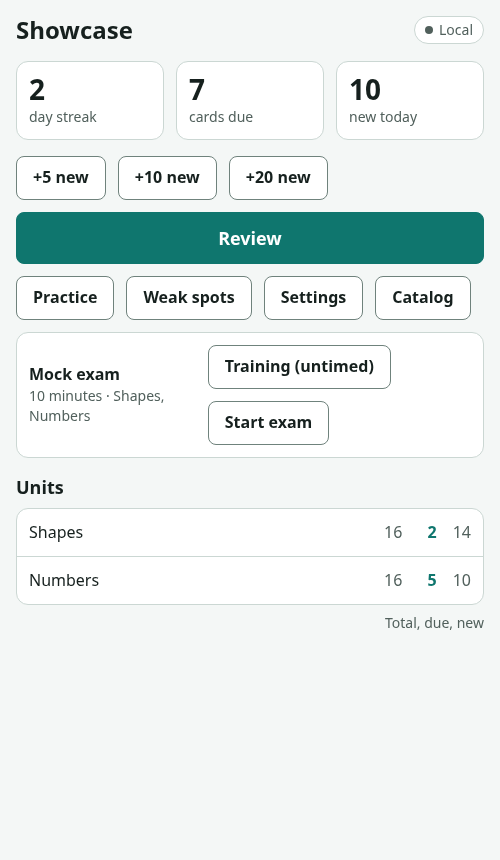
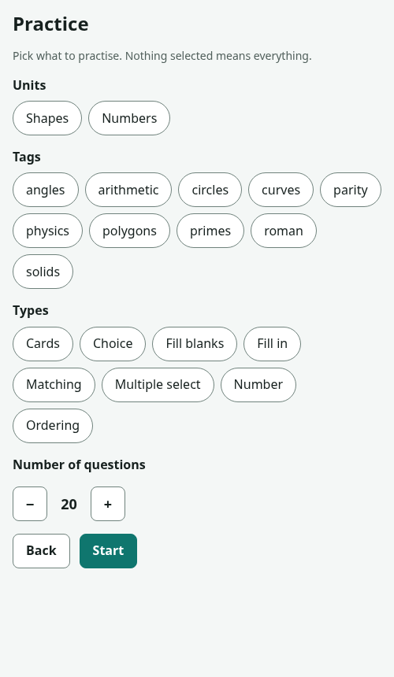
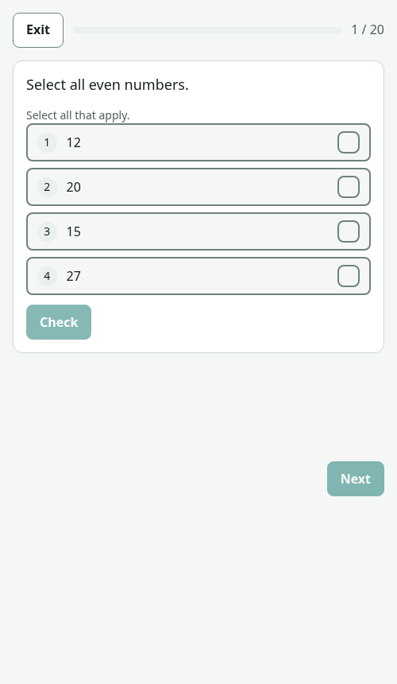
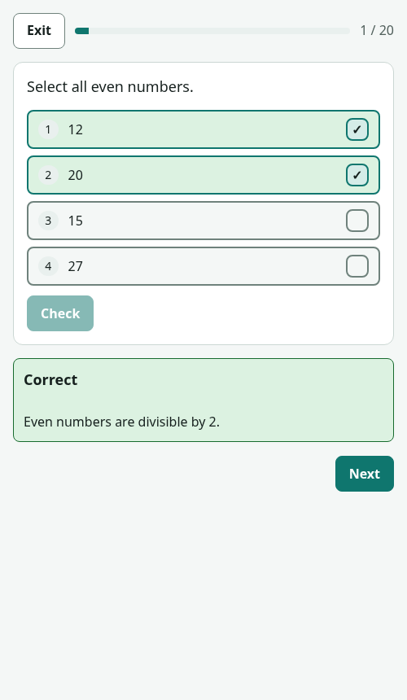
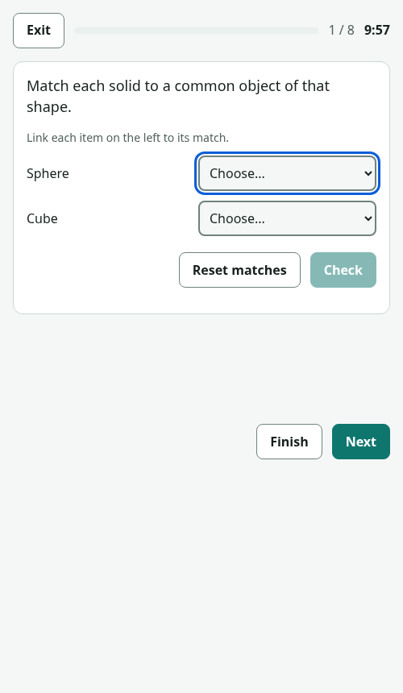

# dojo-kit

A generic exam and test trainer builder. You bring your own materials; an AI coding assistant writes the course files; dojo-kit validates them and builds a single-page trainer app.

- Rust core compiled to WASM (grading, spaced repetition, progress merge, exam sampling), a native `dojo` CLI, and a Preact web UI.
- Content is plain files: `course.json` plus one JSONL file per unit.
- Spaced repetition, placement test, timed mock exams, per-unit settings, build-time plugins.
- Progress storage: browser localStorage, a file you paste/export, or the Claude artifact database.

## Quick start

Needs a Rust toolchain (https://rustup.rs) with the `wasm32-unknown-unknown` target; the `./dojo` wrapper builds the CLI and WASM on demand.

```
./dojo build examples/showcase --out dist/x       # build the demo trainer into dist/x/showcase/
./dojo init my-course --title "My course"         # scaffold workspace/<course>/
./dojo validate workspace/<course> [--json]      # check course.json and content/*.jsonl
./dojo add workspace/<course> <unit-id> --file items.json   # append items (ids assigned)
./dojo lock workspace/<course>                   # rewrite ids.lock; `build` also does this
```

`./dojo schema --brief` prints the item-type cheat-sheet (main fields; `schema/course.schema.json` is the complete reference); `./dojo stats <course-dir>` and `./dojo next-id <course-dir> <prefix>` are also available. Exit codes: 0 ok, 1 validation or build refusal, 2 usage or I/O error.

## Requirements

Required to build and run the trainer (the `./dojo` wrapper checks for `cargo`; `scripts/build-wasm.sh` also uses `rustc`, `sed` and `perl`):
- Rust toolchain via rustup (https://rustup.rs), edition 2024 so a recent stable (`Cargo.toml`), with the WASM target (Rust 1.85+ for edition 2024; developed on 1.99). No `wasm-pack` or `npm` is used.
- Node.js: not needed to author or build a course; used only for the web tests, the dev server (`node web/dev/serve.js`) and vectors (`docs/ARCHITECTURE.md`). The repo states no minimum. Evidence: the tests use `node:test` including `test.describe` and `node --test` (Node 18 or newer needed); the suite was run on Node 22 only (`node --test web/tests/*.test.js`; the directory form fails on Node 22). Use Node 22 or newer; older versions are untested.

For textbooks (`docs/FROM-TEXTBOOKS.md`; all optional, only needed for that route; the commands and package names below were not run or verified in this repo's environment, where none of them are installed):
- `poppler-utils` (`pdftotext`, `pdfinfo`, `pdftoppm`) for PDFs.
- `tesseract-ocr` plus language packs for scans.
- Optional for EPUB: `pandoc` or calibre (`ebook-convert`).

What the AI model may install itself, after telling the user what and why, and only if the user does not object (never with `sudo` unless the user explicitly says yes to that command; if root is needed, give the user the command instead):
- Rust, user-level: `curl --proto '=https' --tlsv1.2 -sSf https://sh.rustup.rs | sh -s -- -y` (the rustup installer; installs into `~/.cargo`, no root), then `. "$HOME/.cargo/env"`.
- WASM target: `rustup target add wasm32-unknown-unknown`.
- Nothing else is installed without asking.

What the user must provide or approve:
- The materials (in `workspace/<id>/materials/`), the exam details and the language choices.
- System packages (need root): Debian/Ubuntu `sudo apt-get install poppler-utils tesseract-ocr` (add `tesseract-ocr-<lang>` for the language, optionally `pandoc` or `calibre`). The model gives the command and waits.
- Node.js, if tests or the dev server are wanted.
- Publishing to Claude: an assistant that can publish artifacts (Claude Code).

## Use it with an AI assistant

Open the repo in your assistant (Claude Code or any other), put your materials into `workspace/<course>/materials/`, and paste a prompt from [docs/PROMPTS.md](docs/PROMPTS.md) (sources in `prompts/`). The assistant follows [AGENTS.md](AGENTS.md): ingest materials, write content, `dojo validate`, `dojo build`, publish. `CLAUDE.md` points Claude Code to the same procedure.

### Test prompt: textbooks in `workspace/<id>/materials/`

```
Open the repository at <path to dojo-kit>. Read AGENTS.md and docs/FROM-TEXTBOOKS.md completely, then build a practice trainer from my textbooks. Course id: <id>. The textbooks (PDF, scans or EPUB) are in workspace/<id>/materials/.

Course: <topic, level, date>. UI language: <en|ru>. Content language: <language>. Exam format (if known, or "take it from the chapter tests"): <sections, questions, minutes, pass rule>.

Steps: check the requirements (README "Requirements"); tell me what is missing and ask before installing anything; never use sudo without asking. Extract text per chapter, write MAP.md and show me the plan, then for each chapter write items only with ./dojo add, run ./dojo validate and ./dojo lock after it and mark the chapter done in MAP.md. Own wording only, short quotes at most. Use the speak field for listening. Put what cannot be expressed into GAPS.md. At the end ./dojo build and report items per unit and type and everything skipped. Do not publish without asking me.

To continue an unfinished course instead: "Resume workspace/<id> following docs/FROM-TEXTBOOKS.md section 8."
```

## What a trainer looks like

Screens of the `examples/showcase` course (`./dojo build examples/showcase`).

| Home | Practice picker | Question | Feedback | Mock exam |
|---|---|---|---|---|
|  |  |  |  |  |

## Repository map

- `crates/dojo-core` - pure Rust logic: content model, answer checks, SRS, progress merge, exam sampling, validation.
- `crates/dojo-wasm` - WASM wrapper (JSON-string ABI) over the core.
- `crates/dojo-cli` - the `dojo` binary.
- `web/` - Preact UI, storage adapters, i18n, styles, dev server.
- `schema/` - generated JSON Schemas for `course.json` and items.
- `examples/` - `demo`, `showcase` courses and an example plugin.
- `docs/` - architecture, module docs, authoring guide, prompts.
- `prompts/` - copy-paste prompts for AI assistants.
- `tests/` - golden vectors, vector generator, WASM smoke test, wrapper script.
- `tools/` - frozen reference JS used to generate the vectors.
- `scripts/` - WASM build script.

## Contributing

Enable the tracked git hooks once per clone: `git config core.hooksPath .githooks`. They refuse a commit whose author or committer email is not a `*@users.noreply.github.com` address, or that stages files under the private course folders under `workspace/`, `dist/` or `.work/`.

## Documentation

- [docs/ARCHITECTURE.md](docs/ARCHITECTURE.md) - project map, data flow, build and test commands.
- [docs/AUTHORING.md](docs/AUTHORING.md) - writing courses and content.
- [docs/FROM-TEXTBOOKS.md](docs/FROM-TEXTBOOKS.md) - PDF/scan/EPUB textbooks to a course.
- [docs/PROMPTS.md](docs/PROMPTS.md) - prompts for AI assistants.
- [CONTRACT.md](CONTRACT.md) - the framework's rules.

## How it was built

The code was written with the help of AI agents: Claude (Anthropic) and Mistral (Vibe and Codestral) agents under human direction and review.

## License

MIT, see [LICENSE](LICENSE).
