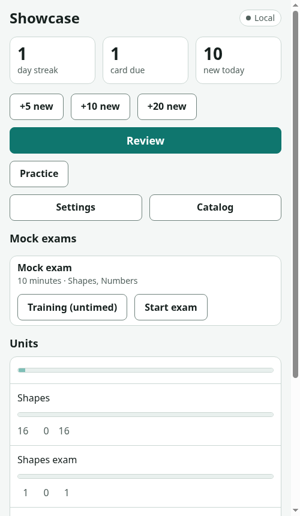
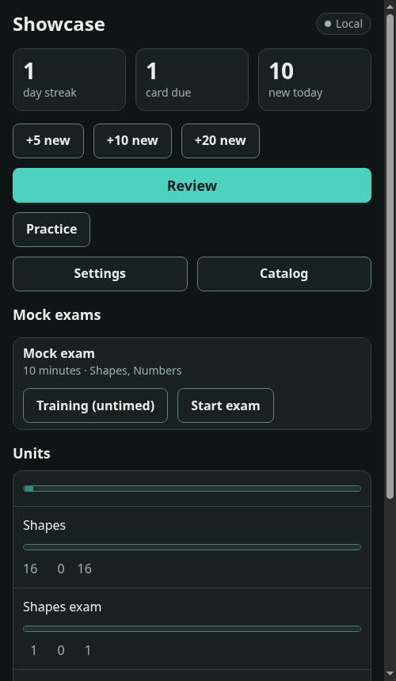
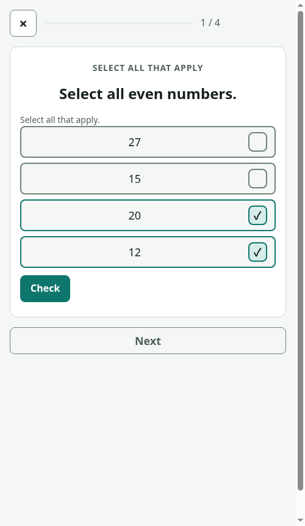
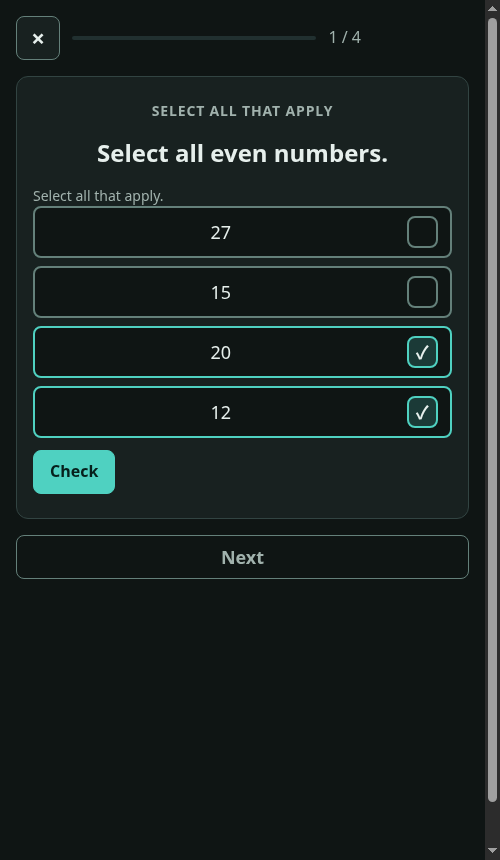

# dojo-kit

**[Live demo](https://camarent.github.io/dojo-kit/)**

[](https://github.com/Camarent/dojo-kit/actions/workflows/ci.yml)
[](https://codecov.io/gh/Camarent/dojo-kit)
[](LICENSE)
[](https://github.com/Camarent/dojo-kit/releases)

For people with study materials (a textbook, lecture notes, past exam questions) who want a practice trainer: you bring the materials, an AI coding assistant writes the course files, and dojo-kit validates them and builds a single-page trainer app you open in a browser. Spaced repetition, placement test, timed mock exams, per-unit settings, build-time plugins; progress lives in localStorage, a file you paste/export, or the host's artifact store.

Under the hood: a Rust core compiled to WASM, a native `dojo` CLI and a Preact web UI; content is plain `course.json` plus one JSONL file per unit.

No Rust toolchain? Use the [live demo](https://camarent.github.io/dojo-kit/) (the showcase course). Building your own trainer needs Rust: no prebuilt download is published yet.

Using an AI assistant? Copy a prompt from [docs/PROMPTS.md](docs/PROMPTS.md); the assistant follows [AGENTS.md](AGENTS.md).

## What a trainer looks like

Screens of the [examples/showcase](examples/showcase) course, the demo behind the live link.

| Light theme | Dark theme |
|---|---|
|  |  |
|  |  |

## Quick start

1. Install Rust (https://rustup.rs), then add the WASM target:

   ```
   rustup target add wasm32-unknown-unknown
   ```

2. Build the demo trainer into `dist/x/showcase/` (the `./dojo` wrapper builds the CLI and WASM on demand):

   ```
   ./dojo build examples/showcase --out dist/x
   ```

3. Open `dist/x/showcase/index.html` in a browser.

4. Scaffold your own course and check it:

   ```
   ./dojo init my-course --title "My course"
   ./dojo validate workspace/<course> [--json]   # checks course.json and content/*.jsonl
   ```

`./dojo schema --brief` prints the item-type cheat-sheet (main fields; `schema/course.schema.json` is the complete reference); `./dojo stats <course-dir>` and `./dojo next-id <course-dir> <prefix>` are also available. Exit codes: 0 ok, 1 validation or build refusal, 2 usage or I/O error.

## Requirements

Rust toolchain and Node.js 24 or newer; full list in [docs/REQUIREMENTS.md](docs/REQUIREMENTS.md).

## Use it with an AI assistant

Open the repo in your assistant (Claude Code or any other), put your materials into `workspace/<course>/materials/`, and paste a prompt from [docs/PROMPTS.md](docs/PROMPTS.md) (sources in `prompts/`). The assistant follows [AGENTS.md](AGENTS.md): ingest materials, write content, `dojo validate`, `dojo build`, publish. CLAUDE.md is a short pointer for tools that read it.

## Repository map

- `crates/dojo-core` - pure Rust logic: content model, answer checks, SRS, progress merge, exam sampling, validation.
- `crates/dojo-wasm` - WASM wrapper (JSON-string ABI) over the core.
- `crates/dojo-cli` - the `dojo` binary.
- `web/` - Preact UI, storage adapters, i18n, styles, dev server.
- `schema/` - generated JSON Schemas for `course.json` and items.
- `modules/` - optional modules (`ja`, `ru`, registry crate); enabled per course with `modules` in `course.json`, see CONTRACT section 13.
- `examples/` - `demo`, `showcase` courses and an example plugin.
- `docs/` - architecture, module docs, authoring guide, prompts.
- `prompts/` - copy-paste prompts for AI assistants.
- `tests/` - golden vectors, vector generator, WASM smoke test, wrapper script.
- `tools/` - frozen reference JS used to generate the vectors.
- `scripts/` - WASM build script.

## Contributing

Tests and lint: see [CONTRIBUTING.md](CONTRIBUTING.md).

## Documentation

- [docs/ARCHITECTURE.md](docs/ARCHITECTURE.md) - project map, data flow, build and test commands.
- [docs/AUTHORING.md](docs/AUTHORING.md) - writing courses and content.
- [docs/FROM-TEXTBOOKS.md](docs/FROM-TEXTBOOKS.md) - PDF/scan/EPUB textbooks to a course.
- [docs/PROMPTS.md](docs/PROMPTS.md) - prompts for AI assistants.
- [CONTRACT.md](CONTRACT.md) - the framework's rules.

## How it was built

The code was written with the help of AI agents: Claude (Anthropic) and Mistral (Vibe and Codestral) agents under human direction and review.

## License

MIT, see [LICENSE](LICENSE).
